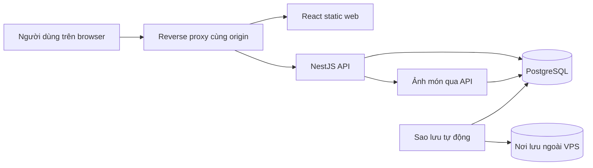

# Kiến trúc hệ thống POS & quản lý kho

> **Trạng thái:** Kiến trúc mục tiêu cho MVP, chưa phải mô tả hệ thống đã chạy. Các quyết định triển khai bên dưới được chốt qua phỏng vấn; nơi chưa chốt được ghi ở mục 13. Khi mã khác tài liệu, kiểm tra cả hai và hỏi trước khi đổi quy tắc nghiệp vụ.

## 1. Cách đọc và nguồn sự thật

Đọc [PRODUCT_OVERVIEW.md](../PRODUCT_OVERVIEW.md) trước để nắm phạm vi, vai trò và bất biến. Quy tắc theo mã BR ở [BUSINESS_RULES.md](../BUSINESS_RULES.md); hợp đồng HTTP chung ở [api-spec.md](../api-spec.md); bảng, công thức và ràng buộc ở [DESIGN_DB_POS_SYSTEM.md](../DESIGN_DB_POS_SYSTEM.md); phiên và mật khẩu ở [auth.md](auth.md); giao diện ở [DESIGN.md](../../DESIGN.md). File này giải thích **ranh giới và luồng giữa các thành phần**, không sao chép đặc tả endpoint hay từng cột DB.

Nếu các nguồn mâu thuẫn về kết quả nghiệp vụ hoặc bảo mật, hỏi người dùng và sửa đồng bộ những tài liệu bị ảnh hưởng. `specs/` ở gốc repository dành cho các đặc tả đã chốt; hiện chưa có file spec.

## 2. Hiện trạng repository và phạm vi MVP

| Thư mục | Hiện trạng khi viết tài liệu | Đích MVP |
| --- | --- | --- |
| `POS_UI/` | React/TypeScript/Vite có màn hình demo; `src/services` gọi `src/mock/mockEngine.ts`, dữ liệu mô phỏng nằm trong browser | Thay lớp service mô phỏng bằng lời gọi API, giữ feature/UI phù hợp |
| `POS_API/` | Chưa có mã ứng dụng | Một ứng dụng NestJS/TypeScript chia module nghiệp vụ |
| `POS_INFRA/` | Chưa có cấu hình triển khai | Docker Compose, reverse proxy, cấu hình production và sao lưu |

UI demo, kể cả đăng nhập, thanh toán và trạng thái offline, **không phải** bằng chứng backend hoặc bán hàng offline đã được triển khai. MVP không bán hàng offline. Chỉ làm tính năng MVP trong mục 5 của product overview; giai đoạn 2 và tùy chọn cần yêu cầu riêng.

## 3. Bối cảnh và ranh giới tin cậy

Browser hiển thị và gửi ý định thao tác; **API là nguồn sự thật** cho giá, tổng tiền, trạng thái hóa đơn/ca, quyền và tồn kho. PostgreSQL là kho dữ liệu bền vững duy nhất của MVP. `store` là ranh giới tenant; `branch` là ranh giới vận hành trong store. `PLATFORM_ADMIN` quản lý store/tài khoản chủ, không đọc dữ liệu vận hành của store.

## 4. Triển khai và vận hành

- Production ban đầu chạy trên **một VPS** tự quản lý. Docker Compose chạy các dịch vụ riêng: reverse proxy, web tĩnh đã build, NestJS API và PostgreSQL. Web/API dùng **cùng origin**; proxy định tuyến đường API đến NestJS, đường web đến React. TLS kết thúc tại proxy. Không chọn sẵn nhà cung cấp VPS hoặc phần mềm proxy.
- PostgreSQL chỉ truy cập qua mạng nội bộ Compose, không công khai cổng DB. Ảnh món cũng nằm trong PostgreSQL. Secret (khóa JWT/CSRF, mật khẩu DB) được cấp qua cấu hình bí mật bên ngoài repository; không nhúng vào image hoặc commit.
- Local dùng UI Vite và các dịch vụ cần thiết để phát triển; chưa có staging riêng. Không suy ra lệnh chạy API/Compose trước khi các manifest tương ứng được tạo. Lệnh UI đang có xem `POS_UI/package.json`.
- Deploy: build image, chạy **lệnh TypeORM migration riêng** trên DB, chỉ đưa API phiên bản mới vào phục vụ khi migration thành công; không để API tự migration lúc khởi động. Migration cần tương thích với thời điểm chuyển phiên bản; khi thất bại, dừng deploy và xử lý/khôi phục theo bản sao lưu.
- Sao lưu PostgreSQL **hằng ngày**, giữ **7 ngày**, lưu **ngoài VPS**; ảnh món trong DB nằm trong cùng bản sao lưu. Kiểm tra khả năng khôi phục định kỳ. Một VPS là điểm lỗi đơn, nên sự cố VPS có thể làm ngừng dịch vụ cho đến khi khôi phục.
- Redis/BullMQ chưa là thành phần MVP mặc định. Chỉ thêm khi một nhu cầu cache/job nền cụ thể được chứng minh và ghi lại quyết định.

## 5. Cấu trúc ứng dụng và chiều phụ thuộc

### 5.1 Backend: một modular monolith

Một tiến trình NestJS, một PostgreSQL, các module theo miền nghiệp vụ. Controller nhận request và trả DTO; guard/validation kiểm tra danh tính, quyền và dữ liệu đầu vào; service giữ quy tắc nghiệp vụ và ranh giới transaction; TypeORM truy cập bảng do module sở hữu. Không đưa entity DB ra thẳng response, không để browser tính giá hoặc trạng thái có thẩm quyền.

| Module dự kiến | Sở hữu và trách nhiệm chính |
| --- | --- |
| Auth & Users | User, role/permission, phiên, cấp và đặt lại mật khẩu |
| Platform & Organization | Store, branch, dining table, trạng thái hoạt động |
| Catalog | Category, product, size, topping, giá, ảnh món |
| Promotions | Mã giảm giá và điều kiện áp dụng |
| Sales | Invoice, item, snapshot, trạng thái đơn và thanh toán |
| Shifts | Ca, chi trong ca, đối soát và tiền trong két |
| Inventory | Ingredient, công thức, tồn theo chi nhánh, sổ kho |
| Reports | Truy vấn doanh thu từ dữ liệu giao dịch đã xác nhận |

Module được gọi qua service có trách nhiệm rõ ràng; không sửa trực tiếp bảng của module khác từ controller. Thao tác cần nhiều module, đặc biệt **thanh toán/hoàn tất đơn 0đ + trừ kho**, được điều phối trong **một TypeORM transaction** với cùng transaction manager. Không phát job bất đồng bộ cho bước quyết định hóa đơn đã thanh toán hoặc tồn kho đã trừ.

### 5.2 Frontend

React chia theo feature và vai trò; lớp service/API client là ranh giới duy nhất gọi HTTP. Khi nối API, thay nguồn mock ở `src/services`, không để màn hình truy cập `mockEngine` như nguồn thật. Access token chỉ ở bộ nhớ; refresh cookie, CSRF và xử lý nhiều request/tab theo [auth.md](auth.md). UI có thể ẩn thao tác theo quyền để dễ dùng, nhưng API luôn kiểm tra lại.

Màn POS ưu tiên tablet ngang và cảm ứng; giao diện tiếng Việt, VND nguyên đồng, giờ hiển thị `Asia/Ho_Chi_Minh` từ timestamp lưu UTC. Không dùng trạng thái offline demo để cho phép tạo đơn/thanh toán khi mất mạng. Cách trình bày cụ thể theo [DESIGN.md](../../DESIGN.md).

## 6. Tenant, danh tính và phân quyền

Guard xác thực phiên và lấy user/role/branch/store **hiện hành** mỗi request theo [auth.md](auth.md). API áp quyền từ `role_permissions`, không dùng tên role cứng trong controller. `store_id` không lấy từ body/query; ID tham chiếu phải thuộc cùng store. Người không có `branch.access_all` bị giới hạn ở branch được gán. Với `OWNER`, branch được xác định theo loại route và bản ghi nguồn, rồi kiểm tra thuộc store như [api-spec.md](../api-spec.md) mục 3.

Mọi truy vấn đọc/ghi cần bộ lọc tenant ở điểm truy cập dữ liệu, kể cả ảnh món, báo cáo và thao tác replay idempotency. `PLATFORM_ADMIN` không được đi qua route dữ liệu vận hành chỉ vì có vai trò cao hơn. Kiểm thử truy cập chéo store/branch là điều kiện bắt buộc trước khi nối UI thật.

## 7. Dữ liệu, ảnh món và thời gian

- PostgreSQL dùng **shared schema**, mỗi bảng có `store_id` hoặc suy ra store qua bảng cha; tồn kho và ca gắn branch. TypeORM entity/migration phải theo [thiết kế DB](../DESIGN_DB_POS_SYSTEM.md), giữ unique/partial index tại DB cho các bất biến đồng thời.
- Tiền là số nguyên đồng (`bigint` ở DB), server tính và chặn từng giá trị/kết quả vượt trần 1.000 tỷ đồng. Hóa đơn giữ snapshot tên và giá khi bán. Thời điểm lưu UTC, chỉ chuyển sang giờ Việt Nam ở ranh giới hiển thị/báo cáo theo quy ước API.
- Mỗi product có tối đa **một ảnh đại diện**, không bắt buộc. Upload `multipart/form-data`, ảnh gốc tối đa **2 MB (2.000.000 byte)**; server kiểm tra loại và nội dung file rồi mã hóa **Base64 thuần** vào cột `products.image_base64` (`text`), lưu MIME riêng. Không nhận chuỗi Base64 từ client và không chọn cột ảnh trong truy vấn danh sách món. `imageUrl` trong response trỏ tới `GET /products/{id}/image` cùng origin, **không** chứa nội dung Base64. Route GET yêu cầu Bearer và kiểm tra đúng store, giải mã Base64 để trả bytes ảnh; web tải bằng `fetch` kèm Bearer rồi hiển thị blob. Không dùng `` trực tiếp cho endpoint cần Bearer.
- Dữ liệu có tham chiếu được ngưng dùng thay vì xóa cứng. `stock_movements` chỉ thêm dòng; sửa sai bằng dòng điều chỉnh. Chi tiết cột và ràng buộc xem tài liệu DB.

## 8. Luồng nghiệp vụ và transaction

### 8.1 Cấp tài khoản và thiết lập

`PLATFORM_ADMIN` tạo store và cấp `OWNER`; `OWNER` tạo branch/menu, cấp nhân viên trong store. Mật khẩu tạm chỉ hiện một lần; tài khoản phải đổi mật khẩu trước khi dùng chức năng khác. Tạm khóa store thu hồi phiên và chặn API; mở lại không khôi phục phiên cũ.

### 8.2 Mở ca, tạo đơn và thanh toán

Tạo đơn cần ca thu ngân đang mở; mỗi bàn chỉ có một đơn `OPEN`. Thêm món lấy giá hiện hành ở DB và lưu snapshot, không nhận giá từ client. Thanh toán một lần bằng một phương thức, đủ toàn bộ; tối đa một mã giảm giá. Đơn còn 0đ dùng hành động hoàn tất riêng, không tạo payment.

Trong một transaction: khóa/kiểm tra invoice và ca, kiểm tra `Idempotency-Key`, ghi payment nếu có, đổi invoice sang `PAID`, trừ tồn kho nguyên tử, thêm `stock_movements`, rồi commit. Bản ghi idempotency và kết quả giao dịch phải nhất quán; gửi lại cùng key/nội dung trả kết quả cũ. Không có trạng thái invoice đã thanh toán nhưng kho chưa trừ. Chi tiết cách replay và lỗi xung đột ở [api-spec.md](../api-spec.md) mục 7.

### 8.3 Đóng ca, đối soát và hủy đơn

Mỗi người chỉ có một ca mở, mỗi branch chỉ có một ca thu ngân mở; không đóng khi còn đơn `OPEN` của ca. Đối soát đếm mù: nhận `counted_cash` trước khi tiết lộ `expectedCash`; tiền chuyển khoản không vào két. Hủy đơn đã trả tiền chỉ theo quyền/lý do/ca còn mở; giữ payment làm lịch sử, hoàn tiền mặt từ két hoặc ghi nhận hoàn chuyển khoản ngoài hệ thống theo quy tắc đã chốt. Ghi hoàn kho bằng dòng sổ mới, không sửa dòng cũ.

### 8.4 Kho và báo cáo

Công thức món theo size và topping dùng chung trong store; tồn theo branch. Cập nhật tồn bằng SQL nguyên tử trong transaction, lưu dòng sổ kho tương ứng. Báo cáo doanh thu lấy từ hóa đơn/giao dịch hợp lệ, loại đơn bị hủy theo quy tắc nghiệp vụ; không lấy từ tổng do browser tự tính.

## 9. API và xử lý lỗi

API theo [api-spec.md](../api-spec.md): JSON response bọc `data` trừ `204`, mã lỗi có cấu trúc, validation ở ranh giới, phân trang theo con trỏ và giới hạn số tiền. Upload ảnh là `multipart/form-data`; endpoint đọc ảnh trả bytes/MIME, không theo JSON envelope. Các thao tác thanh toán và hoàn tất đơn 0đ bắt buộc `Idempotency-Key`; client chỉ retry theo đúng quy tắc key và nội dung. Spec từng endpoint sẽ nằm trong `specs/` khi được viết.

## 10. Đồng thời, nhất quán và hiệu năng

Database constraint bảo vệ một ca mở mỗi người/branch, một đơn `OPEN` mỗi bàn, một payment cho invoice, idempotency key duy nhất và một refresh token hiện hành mỗi phiên. Service dùng transaction/row lock cho thao tác dễ tranh chấp; khi vi phạm unique do request song song, đọc lại trạng thái để trả kết quả hoặc lỗi nghiệp vụ đúng. Cập nhật menu/giá theo lần lưu sau cùng ở MVP, chưa dùng ETag. Index phục vụ truy vấn nóng theo store, branch, trạng thái và thời gian; tránh N+1 theo [rules/database.md](../../rules/database.md).

Một VPS chỉ có một API instance ban đầu. Thiết kế không dựa vào state tiến trình cho tiền/đơn/kho; khi mở rộng nhiều instance, kiểm tra lại rate limit, cache và job trước khi thêm dịch vụ hỗ trợ.

## 11. Bảo mật và vận hành

Xác thực, cookie, refresh rotation, CSRF, mật khẩu và giới hạn thử theo [auth.md](auth.md). Log không chứa secret, token, mật khẩu, dữ liệu cá nhân không cần thiết; có request ID và thông tin lỗi đủ để truy vết. Upload ảnh giới hạn kích thước/định dạng, kiểm tra nội dung thực, không nhận SVG hoặc file có thể thực thi. Reverse proxy giới hạn kích thước request phù hợp 2 MB ảnh cộng overhead multipart.

Theo dõi lỗi API, thời gian phản hồi, tình trạng DB, dung lượng VPS và kết quả sao lưu. Backup phải có bản ngoài VPS; khôi phục được kiểm tra định kỳ. Quy tắc bảo mật chung ở [rules/security.md](../../rules/security.md).

## 12. Kiểm thử và điều kiện hoàn thành

Ưu tiên kiểm thử ranh giới tenant/branch, quyền `PLATFORM_ADMIN`, tiền và idempotency, transaction thanh toán–kho, tranh chấp ca/bàn, đối soát đếm mù, thu hồi phiên và ảnh chỉ đọc được trong store. Test integration dùng PostgreSQL thật cho constraint/transaction/migration; UI kiểm tra luồng với API khi backend có mặt. Không coi demo mock là test backend.

Chạy lệnh build/test thực tế của từng phần khi manifest xuất hiện. Hiện UI có `dev`, `build`, `preview`, `typecheck` trong `POS_UI/package.json`; API và infra chưa có lệnh để chạy. Quy tắc kiểm thử chung ở [rules/testing.md](../../rules/testing.md).

## 13. Quyết định đã chốt và còn mở

| Chủ đề | Quyết định MVP |
| --- | --- |
| Kiến trúc backend | Một NestJS modular monolith, TypeORM và PostgreSQL |
| Production | Một VPS tự quản lý, Docker Compose cho web/API/DB/reverse proxy, cùng origin |
| Migration | Lệnh riêng trước khi phục vụ API mới |
| Môi trường | Local và production; chưa có staging riêng |
| Ảnh món | Một ảnh/product, ảnh gốc tối đa 2 MB, Base64 trong cột `text` của DB; endpoint đọc có Bearer và kiểm tra store |
| Sao lưu | PostgreSQL hằng ngày, giữ 7 ngày, lưu ngoài VPS |

**Còn mở:** nhà cung cấp VPS, phần mềm reverse proxy, nơi lưu bản sao ngoài VPS, định dạng ảnh được phép và lịch kiểm tra khôi phục. Những lựa chọn này không thay đổi quy tắc nghiệp vụ; chốt khi triển khai infra. Nếu đổi một quyết định ở bảng trên, cập nhật file này cùng API/DB/auth có liên quan trước khi viết code.
